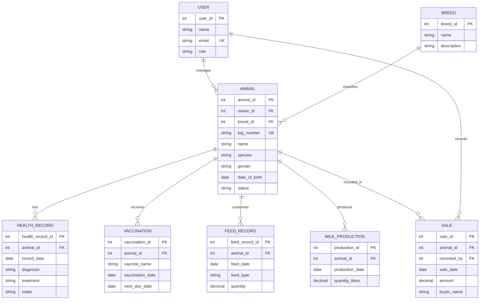

# 🐄 Livestock Manager

**A web-based livestock management system for farmers to manage animals, vaccination records, and farm information in one place.**

Livestock Manager is a full-stack web application designed to simplify livestock record keeping and improve farm management. It provides a role-based experience for farmers and customers, with a dashboard for organizing farm information and monitoring livestock records.

---

## 📌 Table of Contents

- [About the Project](#-about-the-project)
- [Features](#-features)
- [Technology Stack](#-technology-stack)
- [Project Structure](#-project-structure)
- [Getting Started](#-getting-started)
- [Environment Configuration](#-environment-configuration)
- [Running the Application](#-running-the-application)
- [API Endpoints](#-api-endpoints)
- [Security](#-security)
- [Roadmap](#-roadmap)
- [Troubleshooting](#-troubleshooting)
- [Contributing](#-contributing)
- [License](#-license)

## 🌱 About the Project

Managing livestock involves maintaining accurate animal records, tracking vaccinations, and organizing important farm information. Manual record keeping can be time-consuming and difficult to maintain as a farm grows.

Livestock Manager aims to provide a centralized, user-friendly platform where farmers can manage livestock information securely and access relevant farm records.

The application uses a React frontend, a Node.js and Express backend, and MongoDB for persistent data storage.

## ✨ Features

### Authentication and Access Control
- User registration and sign-in.
- Password hashing using bcrypt.
- JWT-based authentication.
- Role-based access for farmers and customers.
- Protected backend routes.

### Farmer Dashboard
- Personalized farmer dashboard.
- Farm overview and livestock summary.
- Farmer-specific data access.
- Dashboard statistics retrieved from the backend.

### Animal Management
- Maintain livestock records.
- View animal information, including identification, type, sex, breed, and weight.
- Search and filter animal records where supported.

### Vaccination Management
- Organize livestock vaccination information.
- Maintain vaccination-related records for farm management.

### Customer Experience
- Separate customer-facing experience.
- Role-restricted access to farmer-only resources.

### System and Database
- MongoDB database integration through Mongoose.
- Backend health endpoint.
- Environment-based configuration.
- Responsive user interface.

> Features are developed incrementally. Refer to the current application for the exact functionality available in each module.

## 🛠️ Technology Stack

| Area | Technologies |
|---|---|
| Frontend | React, Vite, JavaScript, CSS |
| Backend | Node.js, Express.js |
| Database | MongoDB Atlas, Mongoose |
| Authentication | JSON Web Tokens (JWT) |
| Password Security | bcrypt |
| Development Tools | Git, GitHub, VS Code |

## 📁 Project Structure

```text
livestock-management-system/
│
├── frontend/
│   ├── public/
│   ├── src/
│   │   ├── api/
│   │   ├── components/
│   │   ├── App.jsx
│   │   ├── App.css
│   │   └── main.jsx
│   ├── package.json
│   └── vite.config.js
│
├── backend/
│   ├── src/
│   │   ├── config/
│   │   ├── controllers/
│   │   ├── middleware/
│   │   ├── models/
│   │   ├── routes/
│   │   ├── app.js
│   │   └── server.js
│   └── package.json
│
├── .env.example
├── .gitignore
└── README.md
```

*This is the intended high-level structure; individual files may change as development progresses.*

## 🚀 Getting Started

### Prerequisites

Install or create the following before running the application:

- [Node.js](https://nodejs.org/) and npm
- [MongoDB Atlas](https://www.mongodb.com/atlas) account or a compatible MongoDB instance
- [Git](https://git-scm.com/)
- A code editor such as [Visual Studio Code](https://code.visualstudio.com/)

### 1. Clone the Repository

Replace `YOUR_USERNAME` with your GitHub username and use your actual repository name.

```bash
git clone https://github.com/YOUR_USERNAME/livestock-management-system.git
cd livestock-management-system
```

### 2. Install Backend Dependencies

```bash
cd backend
npm install
```

### 3. Configure Environment Variables

From the project root, copy the example environment file to the backend directory.

**Windows PowerShell:**

```powershell
Copy-Item .env.example backend/.env
```

Edit `backend/.env` and configure your own MongoDB connection string and JWT secret.

See [Environment Configuration](#-environment-configuration) below.

### 4. Install Frontend Dependencies

Open a second terminal in VS Code:

```bash
cd frontend
npm install
```

## ⚙️ Environment Configuration

The backend uses environment variables to keep configuration and sensitive values outside the source code.

Example `backend/.env`:

```dotenv
PORT=5000
MONGO_URI=your_mongodb_connection_string
JWT_SECRET=your_long_random_secret
JWT_EXPIRES_IN=1d
```

Replace the example values with your own configuration.

**MongoDB Atlas setup:**

1. Create or select your MongoDB Atlas project.
2. Create a database cluster.
3. Create a database user with only the permissions required by the application.
4. Add your current public IP address under **Security → Network Access**.
5. Copy the Node.js driver connection string and place it in `MONGO_URI`.
6. Replace the username, password, and database name placeholders with your actual values.

Generate a strong, private JWT secret. Never use a sample secret in production.

**Important:** Never commit `backend/.env`, real passwords, JWT secrets, or database connection strings to a public repository. The `.env.example` file should contain placeholders only.

## ▶️ Running the Application

Run the backend and frontend in separate terminals.

### Start the Backend

```bash
cd backend
npm run dev
```

The backend should start on port `5000` when the configuration is correct.

### Start the Frontend

```bash
cd frontend
npm run dev
```

Open the local URL displayed by Vite in your terminal, commonly `http://localhost:5173`.

### Verify the Backend

Open:

```text
http://localhost:5000/api/health
```

When the database connection is healthy, the API should return a response similar to:

```json
{
  "status": "ok",
  "database": "connected"
}
```

The exact response may contain additional fields.

## 🔌 API Endpoints

The following endpoints are part of the current backend structure.

| Method | Endpoint | Purpose |
|---|---|---|
| GET | `/api/health` | Check API and database health |
| POST | `/api/auth/register` | Register an account |
| POST | `/api/auth/login` | Authenticate a user |
| GET | `/api/auth/me` | Retrieve the authenticated user's information |
| GET | `/api/dashboard/summary` | Retrieve the farmer dashboard summary |

The dashboard summary requires authentication and farmer authorization. Additional endpoints may be introduced as the project expands.

## 🔐 Security

Security is important because the application handles user accounts and farm records.

- Passwords are hashed before storage.
- JWTs are used to authenticate protected requests.
- Role-based middleware restricts access to protected resources.
- Environment variables are used for sensitive configuration.
- Database credentials must not be committed to GitHub.
- MongoDB Atlas access should be restricted to trusted IP addresses.
- Production deployments should use HTTPS and appropriate security controls.

If a database password or secret is accidentally pushed to a public repository, rotate it immediately. Removing it from a later commit alone does not make the exposed credential safe.

## 🗺️ Roadmap

Potential future enhancements include:

- [ ] Dedicated super-admin portal with restricted administrative access.
- [ ] Expanded milk production and weight tracking.
- [ ] Breeding management.
- [ ] Farm reports and analytics.
- [ ] Improved vaccination reminders.
- [ ] Customer livestock browsing and marketplace features.
- [ ] Automated testing and deployment.
- [ ] Production deployment and monitoring.

The roadmap may change as the project develops.

## 🧰 Troubleshooting

### Failed to Fetch

- Confirm that the backend is running.
- Check the backend API URL configured in the frontend.
- Verify that the frontend origin is allowed by the backend's CORS configuration.
- Inspect the browser console and backend terminal for errors.

### MongoDB Connection Failed

- Verify that `MONGO_URI` is correct.
- Confirm that your MongoDB Atlas cluster is running.
- Check the database username and password.
- Ensure your current public IP address is allowed in Atlas Network Access.
- Confirm that your network can resolve and reach the Atlas database endpoints.

### Port Already in Use

If port `5000` is already occupied, check whether another backend instance is running before starting another one.

## 🤝 Contributing

Contributions, suggestions, and bug reports are welcome.

1. Fork the repository.
2. Create a feature branch.
3. Make your changes.
4. Run the available checks.
5. Commit your changes with a descriptive message.
6. Open a pull request describing the changes.

Please do not include credentials, private data, or environment files in contributions.

## 🗃️ Entity Relationship Diagram

The core livestock-management data model is represented below. The diagram uses Mermaid ER notation and renders natively in GitHub and compatible Markdown viewers.



## 📄 License

No license has been specified yet. Add a `LICENSE` file if you intend to grant others permission to use, modify, and distribute this project.

---

**Livestock Manager** — making livestock record keeping more organized, accessible, and efficient.
