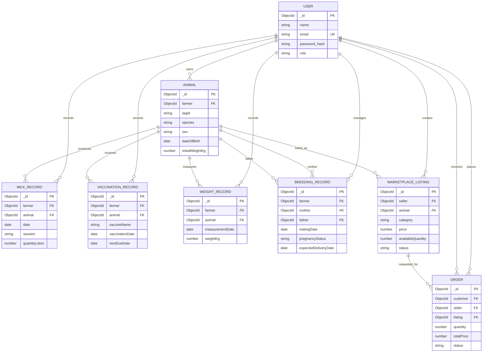

# Livestock Management System

This project contains the existing React/Vite frontend in `frontend/` and a modular Node.js/Express backend in `backend/`.

## Frontend setup

```bash
cd frontend
npm install
npm run dev
```

The frontend runs using Vite and is typically available at `http://localhost:5173`.

## Backend setup

1. Copy the example environment file to `backend/.env` and update `MONGO_URI` if needed:

   ```text
   PORT=5000
   MONGO_URI=mongodb://127.0.0.1:27017/livestock_management
   ```

2. Install backend dependencies:

   ```bash
   cd backend
   npm install
   ```

3. Start the backend in development mode:

   ```bash
   npm run dev
   ```

   Or start it normally with `npm start`.

4. Check the health endpoint at `http://localhost:5000/api/health`.

The backend reads the MongoDB connection string from `MONGO_URI`. The API can start while MongoDB is unavailable so that the health endpoint remains usable: it reports `status: "ok"` and `database: "connected"` when MongoDB is connected, or `status: "degraded"` and `database: "disconnected"` otherwise. The connection string is never included in API responses.

## Phase 1 authentication

Authentication supports two account types: `farmer` and `customer`.

Before starting the backend, add a strong private `JWT_SECRET` to `backend/.env`:

```text
JWT_SECRET=use-a-long-random-secret-here
JWT_EXPIRES_IN=1d
```

The backend exposes:

- `POST /api/auth/register` — create a farmer or customer account with `name`, `email`, `password`, and `role`.
- `POST /api/auth/login` — authenticate with `email` and `password`.
- `GET /api/auth/me` — return the authenticated user with a Bearer token.
- `GET /api/auth/farmer-access` — example farmer-only protected route.
- `GET /api/auth/customer-access` — example customer-only protected route.

Passwords are hashed with bcrypt and are never returned. Authentication uses short-lived JWTs; keep `JWT_SECRET` private and do not commit `backend/.env`.

Run the frontend and backend in separate terminals:

```bash
cd frontend
npm run dev
```

```bash
cd backend
npm run dev
```

Use the frontend at `http://localhost:5173` to register or sign in. Set `VITE_API_URL` only when the API is hosted somewhere other than `http://localhost:5000/api`.

### Authentication verification

Verify the flow with a test account:

1. Register once as a farmer and once as a customer.
2. Confirm each response contains a token and safe user fields, but no password or password hash.
3. Log in with valid credentials and confirm invalid credentials return `401`.
4. Send the token as `Authorization: Bearer <token>` to `/api/auth/me`.
5. Confirm a farmer token is rejected by `/api/auth/customer-access` with `403`, and a customer token is rejected by `/api/auth/farmer-access`.

## Phase 2 farmer dashboard

After a successful farmer login, the frontend opens the protected farmer dashboard. It loads `GET /api/dashboard/summary`, which is scoped to the authenticated farmer and returns zero statistics and empty activity when no animal records exist. The dashboard includes the farmer's animal management workspace. Customers see a separate marketplace placeholder.
## Phase 3 animal management

Farmers can manage their own animal records from **My Animals**. The dashboard summary is calculated from saved records and remains zero-filled until records exist.

Authenticated farmer endpoints:

- `POST /api/animals` - create an animal.
- `GET /api/animals` - list the current farmer's animals. Supports `search`, `species`, `sex`, and `sort` query parameters.
- `GET /api/animals/:id` - view one owned animal.
- `PATCH /api/animals/:id` - update one owned animal.
- `DELETE /api/animals/:id` - delete one owned animal.

Animal IDs are unique per farmer, while separate farmers may reuse the same ID. Every operation is scoped using the authenticated JWT subject rather than a frontend-supplied farmer ID. The frontend provides validation, filters, sorting, responsive records, details, edit, delete confirmation, loading, error, success, and empty states.

## Phase 4 milk records

Farmers can track production from the **Milk Records** dashboard section. Records are linked to animals owned by the authenticated farmer and support morning, afternoon, and evening sessions.

Authenticated farmer endpoints:

- `POST /api/milk-records` - create a milk record.
- `GET /api/milk-records` - list records with `search`, `dateFrom`, `dateTo`, and `session` filters.
- `GET /api/milk-records/:id` - view one owned record.
- `PATCH /api/milk-records/:id` - update one owned record.
- `DELETE /api/milk-records/:id` - delete one owned record.
- `GET /api/milk-records/summary` - return today's litres, current-week litres, separate cow and goat totals for today and the current week, total record count, and production grouped by animal.

Each animal/date/session combination can have one record per farmer. The frontend includes animal selection, validation, date and session filters, edit, delete confirmation, loading, error, success, and empty states. The dashboard summary values are calculated from actual MongoDB records and milk is separated by the linked animal's cow or goat species.

## Phase 5 vaccination records

Farmers can manage preventive care from the **Vaccinations** dashboard section. Records are linked to animals owned by the authenticated farmer and include vaccine name, vaccination date, optional next due date, dose, administrator, and notes.

Authenticated farmer endpoints:

- `GET /api/vaccinations` - list owned vaccination records with optional search and vaccination-date filters.
- `POST /api/vaccinations` - create a vaccination record for an owned animal.
- `GET /api/vaccinations/:id` - view one owned vaccination record.
- `PATCH /api/vaccinations/:id` - update one owned vaccination record.
- `DELETE /api/vaccinations/:id` - delete one owned vaccination record.
- `GET /api/vaccinations/summary` - return total records, due-today, upcoming, and overdue counts.

Records without a next due date are shown as **No due date** and are not counted as overdue. Statuses are calculated from saved dates in the backend. An in-app reminder appears when a vaccination is due within the next three days.

## Phase 6 weight records

Farmers can record measured weights from the **Weight Records** dashboard section. Weight history is calculated only from `WeightRecord` documents; an animal's existing `initialWeightKg` remains profile data and is not treated as a historical measurement.

Authenticated farmer endpoints:

- `GET /api/weight-records` - list owned weight records with optional search, animal, and date filters.
- `POST /api/weight-records` - create a positive weight measurement for an owned animal.
- `GET /api/weight-records/:id` - view one owned weight record.
- `PATCH /api/weight-records/:id` - update one owned weight record.
- `DELETE /api/weight-records/:id` - delete one owned weight record.
- `GET /api/weight-records/animal/:animalId/history` - return ordered measurements and real latest/previous growth calculations for one owned animal.

The frontend displays latest weight, previous weight, kilogram difference, percentage change, and an SVG line chart when at least two saved measurements exist.

## Phase 7 breeding and reproduction

Farmers can manage breeding events from the **Breeding** dashboard section. A breeding record links a female mother and optional same-farm male father, tracks mating method and pregnancy stage, and supports expected/actual delivery, birth outcome, offspring count, and postpartum recovery status. Offspring Animal records are not created automatically.

Authenticated farmer endpoints:

- `GET /api/breeding-records` - list records with search, species, pregnancy-status, and mating-date filters.
- `POST /api/breeding-records` - create a record for an eligible owned mother and optional eligible owned father.
- `GET /api/breeding-records/:id` - view one owned record.
- `PATCH /api/breeding-records/:id` - update one owned record.
- `DELETE /api/breeding-records/:id` - delete one owned record.
- `GET /api/breeding-records/animal/:animalId/history` - view breeding history involving one owned animal.
- `GET /api/breeding-records/upcoming-deliveries` - list upcoming or overdue expected deliveries.
- `GET /api/breeding-records/summary` - return total, confirmed pregnancy, upcoming delivery, delivered, and unsuccessful counts.

Delivery and pregnancy dates are validated against the mating timeline. Delivery outcomes and postpartum statuses are only accepted at the appropriate breeding stage.

## Phase 8 reports and analytics

Farmers can open **Reports** for read-only analytics generated from their saved records. The page includes animal sex/species breakdowns, reproductive classifications, milk trends and totals, vaccination status, breeding/delivery summaries, and selected-animal weight history. Charts use native responsive SVG and CSS; no chart dependency was added.

Authenticated farmer report endpoints:

- `GET /api/reports/overview` - return the combined report payload with optional `dateFrom`, `dateTo`, and `animal` filters.
- `GET /api/reports/animals` - current animal counts and sex/species breakdown.
- `GET /api/reports/reproduction` - female reproductive classifications using the documented priority order.
- `GET /api/reports/milk` - range totals, today/week/month totals, daily/monthly trends, and production by animal.
- `GET /api/reports/vaccinations` - range history plus due-today, upcoming, and overdue counts.
- `GET /api/reports/breeding` - breeding totals and expected delivery list with upcoming/overdue status.
- `GET /api/reports/weights` - selected animal measurements and latest/previous growth calculations.

Report dates use UTC day boundaries. Reproductive reporting classifies females in this order: under eight months, currently pregnancy-confirmed, delivery within the last three months, eligible after a delivery at least three months ago, then other/unclassified. Existing `initialWeightKg` is not treated as a WeightRecord measurement.

The Reports page includes **Print / Save PDF**. Apply any date or animal filters first, then use the button in the animal statistics card and choose **Save as PDF** in the browser print dialog. The print layout hides application navigation and includes only the currently loaded farmer-scoped report data.
## Phase 9 marketplace

The marketplace supports authenticated farmer listings for animals, milk, and feed, plus customer order requests with seller confirmation. No online payment processing is included.

Marketplace endpoints:

- `GET /api/marketplace/listings` - customer browse with search, category, animal type, sex, price, and sort filters.
- `GET /api/marketplace/listings/:id` - view an active listing or an owner's listing.
- `GET /api/marketplace/listings/mine` - farmer's listings.
- `POST /api/marketplace/listings` - farmer creates a listing.
- `PATCH /api/marketplace/listings/:id` - farmer updates or activates/deactivates an owned listing.
- `DELETE /api/marketplace/listings/:id` - delete an owned listing with no order history.
- `POST /api/marketplace/orders` - customer submits an order request.
- `GET /api/marketplace/orders` and `GET /api/marketplace/orders/:id` - customer's own orders.
- `PATCH /api/marketplace/orders/:id/cancel` - customer cancels a pending order.
- `GET /api/marketplace/seller/orders` - farmer's incoming orders.
- `PATCH /api/marketplace/seller/orders/:id/status` - farmer accepts, rejects, or completes an order.

Seller acceptance uses an atomic stock decrement. Animal listings become sold after acceptance; milk and feed listings become sold when their quantity reaches zero. Accepted orders cannot be cancelled in this phase. Customers see only active listings and their own orders, while farmers see only their own listings and incoming orders. The default currency is `LKR`; set `MARKETPLACE_CURRENCY` in `backend/.env` if the project needs a different configured currency.

Farmers have both **Marketplace** (their listings and incoming orders) and **Browse Marketplace** (active listings from the farming community). Customers open the marketplace directly after login.

## Phase 10 assignment readiness

### Project objective

The system gives farmers a secure workspace to manage livestock, production, health, growth, breeding, reports, and marketplace listings. Customers can browse active farm products and submit order requests for seller confirmation. The application is intentionally a manual-confirmation marketplace; it does not process payments.

### Technology and structure

- React 19 and Vite in `frontend/`
- Node.js, Express, and Mongoose in `backend/`
- MongoDB Atlas or another MongoDB deployment for persistent storage
- JWT authentication with farmer and customer roles
- Password hashing with bcryptjs
- Native SVG/CSS charts and browser print-to-PDF for reports

The main backend folders are `backend/src/models`, `backend/src/controllers`, `backend/src/routes`, `backend/src/middleware`, and `backend/src/config`. Frontend API helpers are in `frontend/src/api`, and feature screens/components are in `frontend/src/components`.

### Database relationships



Ownership is enforced by the authenticated JWT subject in backend queries. The `farmer`/`seller`/`customer` fields are never accepted as a substitute for the verified identity. `Order.itemSnapshot` preserves the purchased title, category, unit price, and unit for historical readability.

### Verification commands

Run these commands from the project root in separate terminals:

```bash
cd backend
node --check src/server.js
npm start
```

Check every backend source file with `node --check`, then run:

```bash
cd frontend
npm run lint
npm run build
```

The repository currently has no automated test script. Database-backed CRUD and role-isolation checks should use uniquely identifiable temporary accounts/records and remove only those temporary records after verification. Do not print `backend/.env` or any secret values.

### Genuine screenshots to capture for the report

Capture the running application rather than editor previews. A concise report can use:

1. Farmer login and protected dashboard.
2. My Animals list with Add/Edit/Delete validation visible.
3. Milk Records with separate cow/goat totals.
4. Vaccinations with due/upcoming/overdue status and reminder.
5. Weight Records with history and growth chart.
6. Breeding records with upcoming delivery status.
7. Reports and Analytics with filters and Print/Save PDF control.
8. Farmer marketplace listings/order management.
9. Customer marketplace browse and listing details.
10. Customer order history and seller order status workflow.

Use only screenshots that were actually captured from this application; do not fabricate data or results. Keep the written report within the 10-page assignment limit by combining related screens where appropriate.

### Five-minute demonstration plan

1. (0:00-0:40) Introduce the objective, roles, MERN architecture, and database relationships.
2. (0:40-2:00) Log in as a farmer, create or edit a temporary animal, and show milk, vaccination, weight, and breeding records.
3. (2:00-2:45) Show reports, filters, real summary values, and Print/Save PDF.
4. (2:45-4:20) Show farmer marketplace listing management, customer browsing, order request, seller acceptance, and completion.
5. (4:20-5:00) Demonstrate validation/authorization briefly and summarize limitations: manual seller confirmation, no payment processing, and no automatic offspring creation.

For the final demonstration, prepare the accounts and temporary records beforehand, keep credentials private, and avoid changing existing user data.

## Super Admin Portal

The application now supports three roles: `superadmin`, `farmer`, and `customer`. Public registration accepts only `farmer` and `customer`; the frontend cannot create or promote a superadmin account.

### Secure initial superadmin bootstrap

The initial administrator is created only by the protected server-side bootstrap script. Add temporary private values to `backend/.env` using the names below, then run the script once from the backend directory:

```text
SUPERADMIN_EMAIL=your-private-admin-email
SUPERADMIN_PASSWORD=your-private-password-at-least-12-characters
```

```bash
cd backend
npm run bootstrap:superadmin
```

The script refuses to modify an existing account with that email and does not run during normal server startup. Remove or secure the bootstrap values after the account is created. Never paste them into source code, screenshots, logs, or Git.

### Admin endpoints

All endpoints require `Authorization: Bearer <superadmin-token>` and reject farmer/customer tokens:

- `GET /api/admin/overview` - counts farmers, customers, animals, active listings, and orders.
- `GET /api/admin/users` - search/filter safe farmer and customer account data.
- `GET /api/admin/users/:id` - view safe farmer farm data or customer order data, including linked records.
- `PATCH /api/admin/users/:id/status` - suspend or reactivate an account.
- `PATCH /api/admin/users/:id` - edit a farmer or customer name/email.
- `DELETE /api/admin/users/:id` - delete an account only when it has no dependent records or orders; otherwise suspend it.
- `GET /api/admin/listings` - search/filter marketplace listings across sellers.
- `PATCH /api/admin/listings/:id/moderate` - deactivate or reactivate an eligible listing.
- `PATCH /api/admin/listings/:id` - edit listing title, price, description, image, or available quantity when safe.
- `DELETE /api/admin/listings/:id` - delete a listing only when it has no order history.
- `GET /api/admin/orders` - inspect marketplace order status without changing orders or inventory.
- `GET /api/admin/logs` - read-only administrative action history.

Superadmins also have full administrative CRUD endpoints for saved farmer-owned data. These are intentionally separate from farmer routes and require a target farmer on creation:

- `/api/admin/data/animals`
- `/api/admin/data/milk`
- `/api/admin/data/vaccinations`
- `/api/admin/data/weights`
- `/api/admin/data/breeding`

Each resource supports `GET`, `POST`, `GET/:id`, `PATCH/:id`, and `DELETE/:id`. On `POST`, the backend validates the supplied target farmer and writes ownership from that validated account. On update/delete, ownership is resolved from the stored record rather than trusted from the request. Existing farmer/customer routes and ownership rules are unchanged.

Suspended accounts are checked against MongoDB on every protected request and cannot continue using previously issued JWTs. Administrative actions create audit records containing only the acting user, action, target reference, timestamp, and safe description. Password hashes, tokens, connection strings, and other secrets are never returned or written to audit descriptions.

The admin portal is available after signing in with the bootstrapped account. It includes overview cards, user management, marketplace moderation, order inspection, administration logs, loading/error/empty states, and logout. Farmers and customers continue to use their existing portals.
